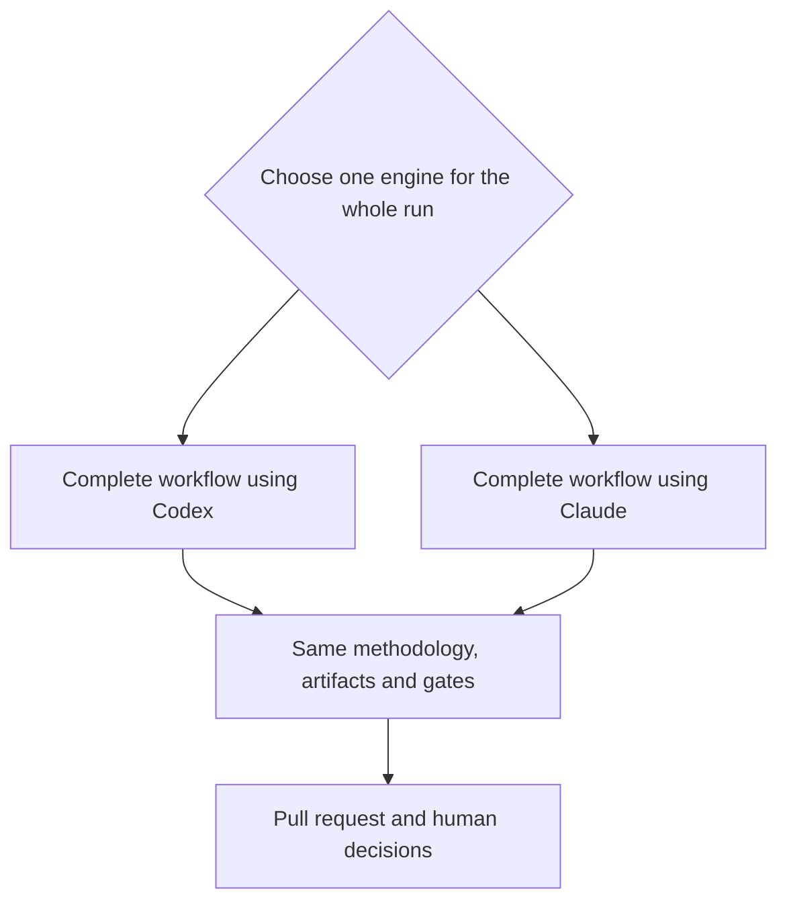

# Multitool Workflow

A shared, spec-driven methodology for building applications with **either Codex or Claude
Code**. Choose the tool when starting a change. That tool executes the complete workflow:
planning, plan review, implementation, mutation analysis, code review, and PR follow-ups.

**One complete change workflow, one engine.** There is no per-step engine routing. You can
run S-01 entirely with Codex and S-02 entirely with Claude. Reviews use fresh sessions of
the selected engine. The methodology, artifact formats, and quality gates remain shared.



This toolkit is installed into an application repository. It does not host the application
or require a central workflow service. Each CLI requires its own authentication and may
consume usage or incur costs according to your account settings.

## Requirements

- Linux or macOS, Python **3.11+**, Git, and Bash. On Windows, use WSL.
- The selected CLI (`codex` **or** `claude`), authenticated and configured. Both are not required.
- For publication: authenticated `gh`, an `origin` remote, and push access.
- The application's toolchain and real gate commands.
- A Git repository with an initial commit and a base branch, usually `main`.

The adapter options were checked against local Codex CLI 0.159.2 and local Claude CLI help.
CLI interfaces can change; verify your installed versions. No model identifiers are hard-coded:
empty model settings use the selected CLI's configured default.

## Install into an application repository

Clone the toolkit outside your application. Pin a reviewed toolkit commit or tag when you
need reproducible installations.

```bash
git clone https://github.com/KrzysztofSikora/multitool-workflow.git
mkdir my-app
cd my-app
git init -b main
git commit --allow-empty -m 'chore: initialize repository'
python3 ../multitool-workflow/install.py .
```

The installer adds:

```text
.workflow-kit/
  run.py                    # shared runner with two alternative adapters
  autonomy.md               # shared decision policy
  config.toml               # application-specific commands and CLI settings
  VERSION                   # source toolkit commit
  skills/mw-*/SKILL.md       # one canonical set of instructions
.agents/skills/mw-*          # Codex discovery links to canonical skills
.claude/skills/mw-*          # Claude discovery links to the same skills
AGENTS.md                   # created only if missing
CLAUDE.md                   # created only if missing; references AGENTS.md
context/                    # application artifacts
```

Installing both discovery directories does not run both tools. The selected adapter is
the only one launched. Existing AGENTS.md and CLAUDE.md are preserved. Existing toolkit
installations or colliding skills block installation. `.workflow/` is added to `.gitignore`.
Global settings, permissions, hooks, and authentication are not changed.

Fill in AGENTS.md with your application's purpose, architecture, data rules, and gates.
If an existing CLAUDE.md does not reference AGENTS.md, add that reference yourself.
Commit the installation before proceeding:

```bash
git add .workflow-kit .agents .claude AGENTS.md CLAUDE.md .gitignore
git commit -m 'chore: install multitool workflow'
```

## Project setup: interactive

Choose your tool for the setup sequence. These examples use Codex; set `ENGINE=claude`
to perform the same sequence with Claude instead.

```bash
ENGINE=codex
python3 .workflow-kit/run.py project shape --engine "$ENGINE" --input brief.md
python3 .workflow-kit/run.py project prd --engine "$ENGINE"
python3 .workflow-kit/run.py project tech-stack --engine "$ENGINE"
python3 .workflow-kit/run.py project roadmap --engine "$ENGINE"
python3 .workflow-kit/run.py project test-plan --engine "$ENGINE"
```

Run these commands one at a time. Review and approve each artifact in the conversation,
then commit it before starting the next step. The brief must already be committed. The
runner requires a clean working tree at entry, including untracked files.

The outputs are `context/shape-notes.md`, `prd.md`, `tech-stack.md`, `roadmap.md`, and
`test-plan.md`. They cover requirements, technology decisions, foundations and vertical
slices, acceptance criteria, risks, and test strategy.

Skills have the `mw-` prefix to avoid built-in command collisions. The runner supplies an
explicit skill path and arguments; it does not depend on `$ARGUMENTS`, slash-command expansion,
or engine-specific fork metadata.

The roadmap must contain an Overview table:

```markdown
## Overview
| ID | Issue | change-id | Status |
|----|-------|-----------|--------|
| F-01 | #1 | scaffold | todo |
| S-01 | #2 | first-feature | todo |
| S-02 | #3 | second-feature | todo |
```

Change IDs use lowercase letters, digits, and hyphens. Issue is an existing GitHub issue
number or `-`. The runner does not create issues.

## Configure quality gates and access

Edit `.workflow-kit/config.toml`. For example, a TypeScript application might use:

```toml
[gates]
fast = ["pnpm typecheck", "pnpm lint", "pnpm test"]
final = ["pnpm typecheck", "pnpm lint", "pnpm test", "pnpm e2e"]

[mutation]
enabled = true
reason = ""
commands = ["pnpm mutation --mutate packages/domain/src/validation.ts"]
```

Use real commands for your project and keep the AGENTS.md gate table synchronized. Fast
gates run before each phase commit; final gates run before independent code review and
after fixes. Mutation can be disabled only with an explicit reason, recorded in its artifact.
Empty fast or final gate lists block execution. For a first scaffold, configure the intended
gates; the implementation phase creates the scripts before the runner executes them.

Configure only the CLI you will use. Codex headless uses `workspace-write` and
`approval_policy="never"`; operations requiring manual permission are denied. Claude uses
`auto` with `--permission-prompts none`. If auto is unavailable, use `acceptEdits` with your
own narrowly configured command permissions. Interactive setup uses the CLI's normal settings.

The runner does not enable permission bypasses or trust hooks automatically. Prepare required
access before starting. Gate and preflight commands are trusted project code executed by the
local runner, outside the model's sandbox, with the runner user's permissions.

```bash
python3 .workflow-kit/run.py doctor --engine codex
```

Doctor checks the chosen CLI and configuration. It does not run a model, gates, or an
authentication test. Commit configuration changes before starting a workflow.

## Run a complete workflow

```bash
# Run the entire first change with Codex; local commits and PR description only:
python3 .workflow-kit/run.py ship S-01 --engine codex

# Run an entirely different change with Claude and authorize publication:
python3 .workflow-kit/run.py ship S-02 --engine claude --publish
```

Each run follows the same sequence:

```text
plan → plan review → plan corrections if needed → implementation phases
     → mutation → final gates → code review → fixes and fresh verification
     → PR description → optional push and pull request
```

The runner records the selected engine in `context/changes/<id>/execution.json`, committed
on the change branch. Every session and receipt uses that engine. Each phase and review
gets a fresh process of the same CLI. There is no `--review-engine` option.

The runner switches the checkout to `change/<change-id>`. The default base is `main`; use
`--base develop` for a different base. A Git-directory lock permits one active runner per
repository, including its worktrees. Agents edit files; the runner owns commits and publication.

Important outputs:

- `plan.md`: phases, decisions D-n, deviations, and open human checks;
- `execution.json`: the selected engine for the complete change;
- `plan-review.md`, `mutation.md`, `review.md`, `pr-body.md`, and optional `evidence/`;
- `.workflow/<id>/state.json`: local step receipts with input fingerprints and artifact hashes;
- `.workflow/<id>/*.jsonl` and gate logs: local diagnostic evidence;
- `.workflow/run-summary.md`: the latest outcome.

Runtime logs are gitignored and are not included in PRs. They may contain code and tool output;
review them before sharing. Never supply secrets to sessions or gate commands.

## Resume and publish

Resume with the **same engine** used to start the change:

```bash
python3 .workflow-kit/run.py resume S-01 --engine codex --publish
```

Trying to resume that Codex change with Claude is rejected. To use Claude, choose a different
roadmap item for a new complete workflow. The committed engine record preserves this rule
across clones; local receipts are supplementary state, not a replacement for the record.
Older mixed-engine receipts are rejected instead of silently accepted.

Completed phases are read from the plan. Changes to code, design decisions, constraints,
or configuration invalidate verification evidence. Missing local state causes review and
required mutation to run again with the recorded engine.

A failed session preserves the diff. Inspect the log, branch, `git status`, and changes.
Repair and commit deliberate changes before resuming; never mark an unverified phase complete.
If a failed phase already ticked its checkbox, restore the checkbox when the phase remains
unfinished. The runner does not automatically stash, reset, or bulk-commit failed work.

Publish an existing local result without another model session:

```bash
python3 .workflow-kit/run.py publish S-01 --engine codex --publish
```

A PR is ready only with completed phases and current plan-review, final-gate, code-review,
and required mutation evidence. Missing or stale evidence produces a draft. Open findings
or unresolved review decisions also keep it draft. The runner never merges PRs.
CLI or gate failures stop locally; bounded review exhaustion can produce a description and
optional draft PR. There is no automatic conversion of arbitrary failed local work into a PR.

## Apply human decisions from a PR

Review costly decisions, deviations, evidence, and human checks. Add comments such as:

```text
D-3: choose option B.
R4: fix timeout handling.
Human check: the screen behaves correctly.
```

Apply them using the engine already assigned to the change:

```bash
python3 .workflow-kit/run.py address-pr 42 --engine codex --publish
# Optionally authorize comments from a specific additional reviewer:
python3 .workflow-kit/run.py address-pr 42 --engine codex --reviewer LOGIN --publish
```

Only open, same-repository `change/*` PRs are supported. The runner fetches the branch,
filters comments by authorized authors, applies decisions, verifies the result, updates
the PR, and posts one combined reply with an entry for each comment. Reply markers prevent
duplicate application. Add a new comment to revise an already handled decision.

## Testing and optional CI

```bash
python3 -m unittest discover -s tests -v
```

Tests use temporary Git repositories and fake CLIs, without paid model sessions. They cover
complete runs with each engine, same-engine resumption, rejection of engine mixing, persistence
of engine selection, gates, review freshness, publication, and authorized comment handling.
Real model execution and authentication still require a pilot in a test application repository.

`templates/github-checks.yml` tests the toolkit on Python 3.11 and 3.13. To activate it,
copy it to `.github/workflows/checks.yml` and commit with credentials allowed to modify
GitHub Actions. Active CI is not installed automatically. Application CI needs its own gates.

## Design assessment and further documentation

The approach is useful when you want one development process with a choice of provider,
without coordinating providers inside a run. It does not guarantee identical decisions or
execution permissions across tools. Read the [design assessment](docs/design-assessment.md)
for the trade-offs, remaining validation, and recommendation.

- [Architecture and contracts](docs/architecture.md)
- [Operations, upgrades, and limitations](docs/operations.md)
- [Shared autonomy policy](workflow/autonomy.md)
- Official [Codex non-interactive mode](https://learn.chatgpt.com/docs/non-interactive-mode),
  [Codex skills](https://learn.chatgpt.com/docs/build-skills), and
  [Claude programmatic usage](https://code.claude.com/docs/en/headless).
