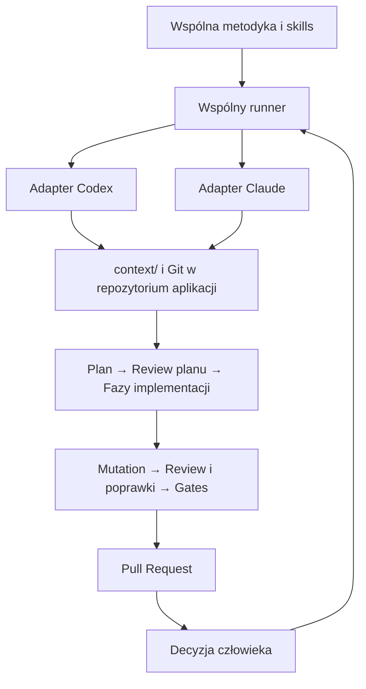

# Multitool Workflow

Jedna metodyka budowania aplikacji, wspólne skills i runner z adapterami **Codex** oraz
**Claude Code**. Możesz wykonać S-01 przez Codex, S-02 przez Claude albo wznowić tę samą
zmianę innym narzędziem. Stan przekazują pliki i Git; historia rozmowy nie jest przenoszona.

To zestaw do instalacji w repozytorium aplikacji. Nie wymaga chmury ani konta aplikacji;
same CLI wymagają własnego logowania i mogą naliczać opłaty zgodnie z Twoim planem.



## Wymagania

- Linux lub macOS, Python **3.11+**, Git i Bash. Windows: WSL.
- Wybrane CLI (`codex` albo `claude`) z działającym logowaniem.
- Przy publikacji: `gh`, `gh auth login`, dostęp do `origin` i możliwość push.
- Toolchain aplikacji oraz przygotowane commands gates; instalator nie instaluje zależności.
- Repozytorium aplikacji z pierwszym commitem i domyślną gałęzią, np. `main`.

Sprawdź pomoc zainstalowanych CLI. Adaptery sprawdzono względem lokalnego Codex CLI
0.159.2 i pomocy lokalnego Claude CLI; formaty opcji mogą zmieniać się pomiędzy wersjami.
Nie są wymagane konkretne modele: pusta nazwa w konfiguracji używa domyślnego modelu CLI.

## 1. Instalacja w nowej aplikacji

Sklonuj ten toolkit poza repozytorium aplikacji. Zamiast `main` można użyć konkretnego
commita/tagu, aby wybrać sprawdzoną wersję.

```bash
git clone https://github.com/KrzysztofSikora/multitool-workflow.git
mkdir moja-aplikacja
cd moja-aplikacja
git init -b main
git commit --allow-empty -m 'chore: initialize repository'
python3 ../multitool-workflow/install.py .
```

Instalator dodaje:

```text
.workflow-kit/             # przypięta kopia runnera i metodyki
  run.py
  autonomy.md
  config.toml
  VERSION                 # commit źródłowy toolkitu
  skills/mw-*/SKILL.md     # jedno źródło instrukcji
.agents/skills/mw-*        # dowiązania do wspólnych skills dla Codex
.claude/skills/mw-*        # dowiązania do tych samych skills dla Claude
AGENTS.md                 # szablon, tylko jeśli plik nie istnieje
CLAUDE.md                 # odsyłacz do AGENTS.md, tylko jeśli nie istnieje
context/                  # artefakty aplikacji
```

Istniejące AGENTS.md i CLAUDE.md pozostają zachowane. Kolizja skill lub istniejący
`.workflow-kit` blokuje instalację. Instalator dopisuje `.workflow/` do `.gitignore`.
Nie zmienia globalnych ustawień, uprawnień, hooków ani logowania żadnego narzędzia.
Jeżeli masz własny CLAUDE.md, dodaj w nim polecenie odczytania AGENTS.md.

Uzupełnij AGENTS.md: opis aplikacji, granice warstw, zasady danych i gates. Następnie
zapisz instalację w Git, wskazując konkretne ścieżki:

```bash
git add .workflow-kit .agents .claude AGENTS.md CLAUDE.md .gitignore
git commit -m 'chore: install multitool workflow'
```

## 2. Projektowanie aplikacji — interaktywnie

Pięć kroków wykonujesz raz dla projektu. Po każdym sprawdź artefakt, zatwierdź go w rozmowie
i zacommituj przed następnym krokiem. Runner wymaga czystego drzewa na wejściu.

```bash
python3 .workflow-kit/run.py project shape --engine codex --input brief.md
python3 .workflow-kit/run.py project prd --engine codex
python3 .workflow-kit/run.py project tech-stack --engine claude
python3 .workflow-kit/run.py project roadmap --engine codex
python3 .workflow-kit/run.py project test-plan --engine claude
```

Powstają kolejno `context/shape-notes.md`, `prd.md`, `tech-stack.md`, `roadmap.md`,
`test-plan.md`. Brief powinien być wcześniej zapisany i zacommitowany w repozytorium.
Metodyka obejmuje wymagania testowalne, decyzje technologiczne, fundamenty i pionowe
przekroje funkcjonalne, ryzyka oraz strategię testów.

Możesz też poprosić narzędzie w zwykłej rozmowie o odczytanie odpowiedniego SKILL.md.
Prefiks `mw-` unika konfliktu z wbudowanymi poleceniami typu `/review`. Runner czyta
instrukcje przez ścieżkę — nie zależy od obsługi slash commands ani `$ARGUMENTS`.

Roadmap musi mieć tabelę Overview z kolumnami:

```markdown
## Overview
| ID | Issue | change-id | Status |
|----|-------|-----------|--------|
| F-01 | #1 | scaffold | todo |
| S-01 | #2 | first-feature | todo |
```

`change-id`: małe litery, cyfry i myślniki. Issue to istniejący numer issue GitHub lub `-`.
Runner nie tworzy issues automatycznie.

## 3. Konfiguracja gates i uprawnień

Edytuj `.workflow-kit/config.toml`, np. dla aplikacji TypeScript:

```toml
[gates]
fast = ["pnpm typecheck", "pnpm lint", "pnpm test"]
final = ["pnpm typecheck", "pnpm lint", "pnpm test", "pnpm e2e"]

[mutation]
enabled = true
reason = ""
commands = ["pnpm mutation --mutate packages/domain/src/validation.ts"]
```

Komendy muszą już działać. `fast` uruchamia się po każdej fazie, przed commitem; `final`
przed niezależnym code review. Polecenia są zaufanym kodem projektu wykonywanym przez Bash
na Twoim komputerze. Runner sam nie ogranicza ich dostępu do sieci lub urządzeń.

Mutation można wyłączyć, ale wymaga jawnego `reason`; pominięcie jest zapisane w artefakcie
oraz powinno być pokazane w PR. Puste fast/final blokują przebieg. Przy pierwszym scaffold
przygotuj commands docelowe; etap implementacji tworzy skrypty i uruchamia je przed commitem.

Codex headless używa `workspace-write` i `approval_policy="never"`: operacja wymagająca
ręcznej zgody będzie odmówiona. Claude domyślnie używa `auto` z `--permission-prompts none`.
Dostępność auto zależy od Twojego CLI/konta; można ustawić `acceptEdits` z własnymi
uprawnieniami do koniecznych poleceń. Interaktywne kroki projektu zachowują ustawienia CLI.

Nie ma domyślnego bypassu sandboxa, automatycznego zaufania hookom ani modyfikacji globalnych
allowlists. Jeśli testy wymagają dodatkowych zasobów, skonfiguruj dostęp przed runem. Zasada
„nie pytaj w trakcie” nie nadaje uprawnień. Hooki mogą być dodatkową ochroną, lecz nie są
wymagane do przekazywania stanu i kontroli wyników przez runner.

```bash
python3 .workflow-kit/run.py doctor --engine codex
```

Doctor sprawdza CLI i konfigurację; nie uruchamia modeli, gates ani testu logowania.
Po konfiguracji zacommituj zmiany przed uruchomieniem ship.

## 4. Wykonanie roadmap item

```bash
# Lokalne commity i opis PR, bez push i GitHub:
python3 .workflow-kit/run.py ship S-01 --engine codex

# Z autoryzacją publikacji branch i PR:
python3 .workflow-kit/run.py ship S-01 --engine claude --publish

# Implementacja Codex, niezależne review przez Claude:
python3 .workflow-kit/run.py ship S-01 --engine codex --review-engine claude --publish
```

Przebieg: plan → review planu → ewentualne poprawki planu → implementacja jednej fazy na
świeżą sesję → mutation → gates → review → poprawki → ponowne mutation/gates/review → opis PR.
Każdy krok ma osobny proces CLI. Runner wykonuje commity i publikację; agent tylko edytuje.

Runner przełącza checkout na `change/<change-id>`. Domyślny base to `main`; inny wybierasz
przez `--base develop`. Blokada w wspólnym katalogu Git dopuszcza jeden runner na repozytorium,
także dla jego worktrees. Pierwsza wersja celowo nie uruchamia równoległych zmian w jednym repo.

Wynik zawiera:

- `context/changes/<id>/plan.md`: fazy, decyzje D-n, odchylenia, otwarte human checks;
- `plan-review.md`, `mutation.md`, `review.md`, `pr-body.md` i ewentualne `evidence/`;
- `.workflow/<id>/state.json`: potwierdzenia kroków z fingerprintem wejść i hashami artefaktów;
- `.workflow/<id>/*.jsonl`, gate logs: lokalne logi sesji i weryfikacji;
- `.workflow/run-summary.md`: ostatni przebieg.

Logi mogą zawierać fragmenty kodu i odpowiedzi narzędzi. Są gitignored, nie trafiają do PR.
Nie podawaj sekretów modelowi ani commands gates. Runner nie jest skanerem sekretów.

## 5. Wznowienie i zmiana narzędzia

```bash
python3 .workflow-kit/run.py resume S-01 --engine claude --publish
```

Ship i resume używają tej samej walidacji. Ukończone fazy są odczytywane z planu, a aktualne
review/mutation z potwierdzeń. Zmiana kodu, planu, zasad lub konfiguracji unieważnia dowody.
Nowy engine nie potrzebuje historii rozmowy poprzednika.

Po błędzie runner zachowuje diff. Nie robi automatycznie `git add -A`, stash ani reset.
Sprawdź `git status`, log i diff; popraw/commituj potrzebne pliki, następnie wznow.
Jeśli implementacja zdążyła zaznaczyć fazę przed nieudanym gate, zweryfikuj ją i cofnij
checkbox, jeśli faza rzeczywiście pozostaje niedokończona. Nie zatwierdzaj niezweryfikowanej fazy.

Samo przygotowanie planu i review w nowym clone nie odtwarza lokalnych potwierdzeń;
review oraz mutation będą wykonywane ponownie. Poza checkboxami ukończonych faz runner
nie ufa deklaracjom z rozmowy. Nie tworzy commita automatycznie dla nieudanego kroku.

Publikacja przygotowanego wyniku bez kolejnej sesji:

```bash
python3 .workflow-kit/run.py publish S-01 --engine codex --publish
```

PR jest gotowy tylko przy aktualnym zaakceptowanym review planu, ukończonych fazach,
aktualnych final gates, code review bez otwartych findings i wymaganym mutation. Brak dowodów
lub nierozwiązane review oznacza draft. Aktualizacja istniejącego PR może przywrócić draft.
Runner nigdy nie scala PR. Nieudane gates zatrzymują lokalnie; opis PR można przygotować
po ręcznej ocenie zachowanego diffu. Limity review kończą się opisem i opcjonalnym draft PR.

## 6. Decyzje człowieka w PR

Sprawdź sekcję decyzji, odchylenia, evidence i human checks. Komentarze mogą wskazywać np.:

```text
D-3: wybierz opcję B.
R4: popraw obsługę timeout.
Human check: ekran działa poprawnie.
```

Następnie:

```bash
python3 .workflow-kit/run.py address-pr 42 --engine codex --publish
# Jeżeli autoryzujesz także uwagi konkretnego współpracownika:
python3 .workflow-kit/run.py address-pr 42 --engine claude --reviewer LOGIN --publish
```

Obsługiwane są otwarte PR w tym samym repo, z branch `change/*`. Runner pobiera nowy stan
branch, filtruje komentarze według zaufanych autorów, stosuje uwagi, weryfikuje zmianę,
aktualizuje PR i publikuje jedną zbiorczą odpowiedź z pozycją dla każdego komentarza.
Markery odpowiedzi chronią przed ponownym zastosowaniem już obsłużonych komentarzy.
Fork PR nie jest obsługiwany. Nie traktuj komentarzy innych autorów jako autoryzacji działań.

## Testowanie toolkitu

```bash
python3 -m unittest discover -s tests -v
```

Testy instalują toolkit w tymczasowych repozytoriach i wykonują przebiegi z atrapami CLI.
Obejmują oba adaptery, zmianę engine przy wznowieniu, fazy, gates, aktualność dowodów,
blokadę runów i ochronę przed nadpisaniem instalacji. Nie uruchamiają płatnych modeli.
Rzeczywiste sesje modeli oraz zdalna publikacja wymagają osobnego pilota w repo aplikacji.

## Opcjonalne GitHub Actions

Szablon `templates/github-checks.yml` uruchamia testy toolkitu dla Python 3.11 i 3.13.
Aby włączyć go w tym repo, skopiuj plik do `.github/workflows/checks.yml` i zacommituj.
Logowanie użyte do push musi pozwalać na zmianę GitHub Actions (scope `workflow` lub
odpowiednie uprawnienie tokena). Pierwsza publikacja zawiera szablon, bez aktywnego CI.
To CI testuje toolkit; aplikacja powinna mieć własną konfigurację gates w swoim CI.

## Dalsza dokumentacja

- [Architektura i kontrakty](docs/architecture.md)
- [Aktualizacja i ograniczenia](docs/operations.md)
- [Zasady autonomii](workflow/autonomy.md)
- Oficjalny [Codex non-interactive](https://learn.chatgpt.com/docs/non-interactive-mode),
  [Codex skills](https://learn.chatgpt.com/docs/build-skills) i
  [Claude programmatic usage](https://code.claude.com/docs/en/headless).
