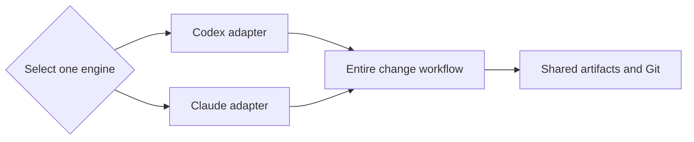

# Architecture and contracts

## Execution model

Select **one engine for a complete change workflow**. Planning, plan review, implementation,
mutation, code review, corrections, and PR follow-ups all run through that engine's adapter.
There is no per-step routing. A different roadmap item may select the other engine.

The shared runner owns sequencing, state, verification, commits, and publication. The
adapter owns CLI invocation and engine-specific options. Canonical skills define the
methodology independently of CLI tool names or command expansion.

Both discovery directories link to the same instructions. This does not launch both tools.
Only the chosen CLI is required for execution. Explicit file paths replace assumptions about
slash commands, argument substitution, background tools, or fork metadata.

## Engine selection and review separation

`context/changes/<id>/execution.json` stores the chosen engine and is committed to the change
branch. Local state also records the engine and each receipt identifies the executing tool.
Conflicting selection or legacy mixed-engine receipts stop the run. Resume and PR follow-ups
keep the same engine. No CLI option overrides the engine for a specific step.

Reviews run in fresh processes of the selected CLI, receiving the plan, code, and evidence
rather than the author's conversation history. This separates session context, not model
identity: correlated blind spots remain possible and human review is still required.

## Artifacts

| Artifact | Meaning |
|----------|---------|
| shape-notes, prd, tech-stack, roadmap, test-plan | Interactive project design |
| changes/id/execution.json | Selected engine for the complete change |
| plan.md | Goals, decisions, phases, human checks, deviations |
| plan-review.md | READY / READY WITH NOTES / NEEDS CHANGES |
| mutation.md | Mutation report or explicit skip reason |
| review.md | APPROVE / APPROVE WITH FOLLOW-UPS / CHANGES REQUESTED |
| pr-body.md | First line `# <title>`, followed by the PR body |
| replies.md | One reply entry per authorized comment |
| .workflow/id/state.json | Local receipts with input and artifact hashes |
| .workflow/id/gates.json | Gate results for a specific input fingerprint |

Plans and reviews use the contracts in their skills. `Verdict:` and `- Decision: open` are
strict parser inputs. Phases have consecutive numbers and must be completed in order. Each
implementation session ticks exactly one phase, independently checked before the runner commit.

## Verification freshness

The application fingerprint covers paths, contents, and file modes in Git and nonignored
new files, excluding `context/` and `.workflow/`. Receipts additionally include the plan,
PRD, tech stack, test plan, lessons, and configuration. Artifact hashes detect replacement.

Editing PR prose does not invalidate code review. Completing Progress checkboxes does not
invalidate accepted design; new decisions or other substantive plan changes require review.
Fixes require new final gates and code review. Marking findings fixed is not reviewer approval.
Required mutation evidence is also refreshed after relevant changes.

## Git and publication ownership

The runner requires a clean tree, including untracked files, before execution. It checks
branch and HEAD after each session and stages explicit changed paths for commits. Failed
work remains available for inspection; there is no automatic stash, reset, force push, or
bulk WIP commit. Ordinary Git commit hooks still run.

These are post-execution checks, not a sandbox against a deliberately disobedient agent.
The selected CLI's permissions and execution environment are the actual access boundaries.
Gate/preflight commands are trusted local commands outside the model sandbox.

`--publish` authorizes ordinary branch push and PR creation/update. Stale or incomplete evidence
keeps the PR draft, including demotion of a previously ready PR. Merging remains a human action.
PR comments are filtered by explicitly authorized authors before becoming agent instructions.
